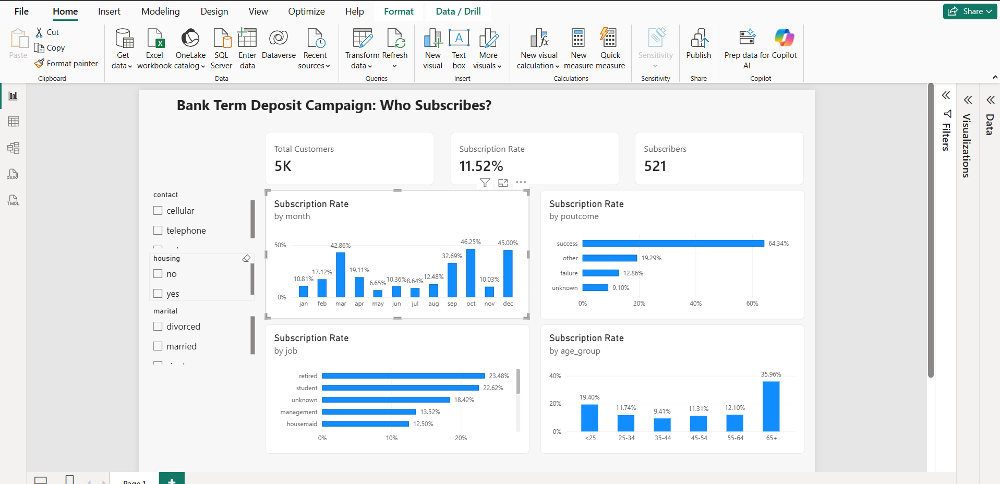

# Bank Term Deposit Campaign: Who Subscribes?

A Power BI dashboard that shows which bank customers are most likely to subscribe to a term deposit, so a campaign team knows who to call first.

## Data
UCI Bank Marketing dataset: 4,521 customers, 521 subscribers (11.52% subscription rate). The call-duration column was removed because it is only known after a call is made.

## Key findings
- Customers with a previous campaign success subscribe at 64.3%, against 9.1% with no previous campaign.
- Retired customers (23.5%) and customers aged 65+ (36.0%) respond best.
- May has the most calls (1,398) but converts at only 6.7%.

## Tools
Power BI Desktop, DAX measures (Subscription Rate, Baseline Rate, Lift vs Baseline), Python (pandas) for data preparation.

## Files
- `bank_marketing_dashboard.pbix`: the dashboard
- `bank_marketing_clean.csv`: the prepared data
- `dashboard.png`: screenshot
